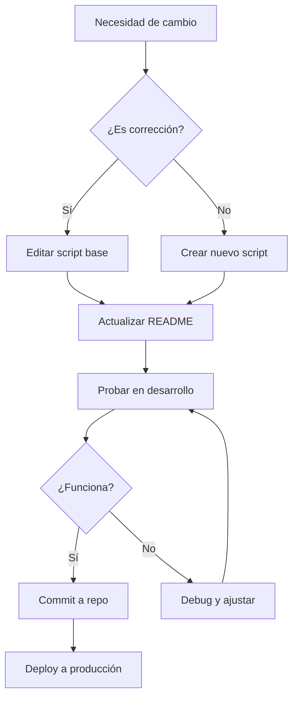

# Scripts Modulares de Base de Datos - Sistema Finah

Este directorio contiene los scripts SQL modulares del sistema Finah, divididos en archivos más pequeños y manejables para facilitar el mantenimiento y la comprensión del esquema de base de datos.

## 🎯 Filosofía de Trabajo con la Base de Datos

### Principio de Modularidad
Los scripts SQL están organizados de manera **modular** para facilitar el mantenimiento, debugging y escalabilidad. Cada script tiene una **responsabilidad específica** y está numerado según su orden de dependencia.

### Metodología de Modificaciones

#### ✅ **CORRECTO: Integrar cambios en scripts base**
Cuando realizas una modificación o corrección a la estructura de la base de datos:
1. **Identifica el script base** donde vive la funcionalidad (ej: `03_tablas_grupos_y_cuentas.sql`)
2. **Edita directamente el script base** con la nueva estructura
3. **Documenta el cambio** en el script con comentarios
4. **Actualiza este README** con los cambios realizados
5. **Elimina scripts temporales** de fix si existían

**Ejemplo**: Si cambias la estructura de `grupos_usuario`, modificas `03_tablas_grupos_y_cuentas.sql`, NO creas un `15_fix_grupos_usuario.sql`.

#### ❌ **INCORRECTO: Scripts temporales de fix**
- NO crear scripts numerados tipo `14_fix_algo.sql` o `15_fix_otro.sql`
- Estos scripts crean confusión sobre el estado real del esquema
- Dificultan saber qué versión de la tabla es la correcta

#### 🆕 **Agregar Nueva Funcionalidad**
Para agregar una **nueva funcionalidad completa** (no una corrección):
1. **Crea un nuevo script numerado** siguiendo la secuencia (ej: `11_nuevo_modulo.sql`)
2. **Documenta las dependencias** en el encabezado del script
3. **Agrégalo al orden de ejecución** en este README
4. **Actualiza el resumen de componentes**

**Ejemplo**: Sistema de notificaciones push → `11_sistema_notificaciones_push.sql`

### Estructura de un Script Base

```sql
-- ============================================
-- SCRIPT: XX_nombre_funcionalidad.sql
-- DESCRIPCIÓN: Propósito del script
-- DEPENDENCIAS: Scripts 01, 02, etc.
-- ÚLTIMA MODIFICACIÓN: YYYY-MM-DD
-- ============================================

-- Extensiones/Preparación
-- ...

-- Tablas
DROP TABLE IF EXISTS mi_tabla CASCADE;
CREATE TABLE mi_tabla (
    -- Estructura completa actualizada
);

-- Funciones
DROP FUNCTION IF EXISTS mi_funcion() CASCADE;
CREATE OR REPLACE FUNCTION mi_funcion() ...

-- Triggers
DROP TRIGGER IF EXISTS mi_trigger ON mi_tabla;
CREATE TRIGGER mi_trigger ...

-- Índices
CREATE INDEX IF NOT EXISTS idx_mi_indice ON mi_tabla(...);

-- Comentarios de documentación
COMMENT ON TABLE mi_tabla IS 'Descripción';
```

---

## 📝 Historial de Actualizaciones Importantes

### Diciembre 2024 - Estandarización del Sistema de Iconos

**Problema Original**:
- Tabla `grupos_usuario` usaba campo `imagen_url VARCHAR` para iconos
- Inconsistente con tabla `categorias` que usa `biblioteca_iconos ENUM` + `nombre_icono VARCHAR`

**Solución Implementada** (en `03_tablas_grupos_y_cuentas.sql`):
```sql
-- ANTES:
imagen_url VARCHAR(500)

-- DESPUÉS:
biblioteca_iconos biblioteca_iconos DEFAULT 'material' NOT NULL,
nombre_icono VARCHAR(100) DEFAULT 'group' NOT NULL
```

**Archivos Modificados**:
- ✅ `sql/modular/03_tablas_grupos_y_cuentas.sql` - Estructura actualizada
- ✅ `src/stores/groups.js` - Queries actualizadas (`fetchGroups`, `createGroup`, etc.)
- ✅ `src/views/modules/Groups/components/GroupFormDialog.vue` - IconPicker integrado
- ✅ `src/views/modules/Groups/index.vue` - Renderizado condicional de iconos
- ✅ `src/views/modules/Groups/GroupDetails.vue` - Display actualizado

**Beneficios**:
- ✅ Consistencia en todo el sistema
- ✅ Soporte para múltiples bibliotecas de iconos (Material Symbols, PrimeIcons)
- ✅ Validación a nivel de base de datos con ENUM
- ✅ Mejor performance con índice `idx_grupos_usuario_icono`

### Diciembre 2024 - Corrección de Relaciones FK en miembros_grupo

**Problema Original**:
- FK `miembros_grupo.usuario_id` no tenía `ON DELETE CASCADE`
- Errores al eliminar usuarios del sistema

**Solución Implementada** (en `03_tablas_grupos_y_cuentas.sql`):
```sql
CREATE TABLE miembros_grupo (
    -- ...
    usuario_id UUID NOT NULL REFERENCES profiles(id) ON DELETE CASCADE,
    -- ...
);
```

**Beneficios**:
- ✅ Integridad referencial correcta
- ✅ Eliminación en cascada automática
- ✅ Prevención de registros huérfanos

### Diciembre 2024 - Función para Evitar Recursión RLS

**Problema Original**:
- Al crear grupo, trigger intentaba acceder a `miembros_grupo` con RLS habilitado
- Causaba error de permisos en creación de grupos

**Solución Implementada** (en `03_tablas_grupos_y_cuentas.sql`):
```sql
CREATE OR REPLACE FUNCTION crear_grupo_con_propietario(
    p_propietario_id UUID,
    p_nombre VARCHAR,
    -- ... otros parámetros
)
RETURNS UUID
LANGUAGE plpgsql
SECURITY DEFINER -- ⚡ Clave para evitar RLS
SET search_path = public
AS $$
-- Lógica de creación
$$;
```

**Beneficios**:
- ✅ Creación de grupos sin errores de RLS
- ✅ Propietario automáticamente agregado como miembro
- ✅ Transacción atómica (grupo + miembro)

---

## 📋 Orden de Ejecución

Los scripts deben ejecutarse en el siguiente orden estricto para respetar las dependencias entre tablas y funciones:

### 1️⃣ **01_extensiones_y_tipos.sql**
- **Descripción**: Crea las extensiones necesarias (pgcrypto) y todos los tipos ENUM personalizados
- **Dependencias**: Ninguna
- **Contenido**:
  - Extensión `pgcrypto` para UUIDs
  - 10 tipos ENUM: `tipo_transaccion`, `tipo_meta`, `periodicidad`, `biblioteca_iconos`, `severidad`, `rol_grupo`, `estado_invitacion`, `dia_semana`, `frecuencia_transaccion`, `criterio_finalizacion`

### 2️⃣ **02_tablas_catalogos.sql**
- **Descripción**: Crea las tablas de catálogos básicos del sistema
- **Dependencias**: Script 01
- **Contenido**:
  - Tabla `grupos_categoria` - Grupos de categorías (Hogar, Transporte, etc.)
  - Tabla `categorias` - Categorías específicas (Gasolina, Supermercado, etc.)
  - Tabla `niveles` - Niveles de prioridad (Necesario, Lujo, etc.)
  - Tabla `periodicidades` - Catálogo de frecuencias
  - Tabla `bancos` - Instituciones bancarias
  - Tabla `jerarquias_usuario` - Jerarquías personalizadas de niveles

### 3️⃣ **03_tablas_grupos_y_cuentas.sql**
- **Descripción**: Crea las tablas de grupos de usuarios y cuentas financieras
- **Dependencias**: Scripts 01, 02
- **Última actualización**: Diciembre 2024
- **Contenido**:
  - Tabla `grupos_usuario` - Grupos familiares/compartidos
    - ⚡ **ACTUALIZADO**: Sistema de iconos estandarizado (`biblioteca_iconos` + `nombre_icono`)
    - ⚡ **ACTUALIZADO**: Índice `idx_grupos_usuario_icono` para performance
  - Función `crear_grupo_con_propietario()` - Evita recursión RLS (SECURITY DEFINER)
  - Tabla `cuentas` - Cuentas financieras (efectivo, bancarias, tarjetas)
  - Tabla `miembros_grupo` - Miembros y roles en grupos
    - ⚡ **ACTUALIZADO**: FK `usuario_id` con `ON DELETE CASCADE`
  - Tabla `reglas_reparto_grupo` - Distribución de gastos
  - Tabla `historial_saldos` - Auditoría de cambios en saldos

### 4️⃣ **04_tablas_transacciones.sql**
- **Descripción**: Crea las tablas relacionadas con transacciones y compras
- **Dependencias**: Scripts 01, 02, 03
- **Contenido**:
  - Tabla `transacciones` - Todas las transacciones financieras (con soporte MSI)
  - Tabla `divisiones_transaccion` - División de gastos grupales
  - Tabla `compras_deuda` - Compras financiadas
  - Tabla `cuotas_deuda` - Cuotas de financiamientos
  - Tabla `compras_msi` - Meses Sin Intereses
  - Tabla `reglas_recurrentes` - Transacciones automáticas
  - Tabla `metas` - Metas financieras
  - Tabla `notificaciones` - Notificaciones del sistema

### 5️⃣ **05_tablas_transacciones_periodicas.sql**
- **Descripción**: Crea las tablas para transacciones periódicas y programadas
- **Dependencias**: Scripts 01, 02, 03, 04
- **Contenido**:
  - Función `update_updated_at_column()` - Actualización automática de timestamps
  - Tabla `transacciones_periodicas` - Transacciones recurrentes y MSI
  - Tabla `ejecuciones_transacciones_periodicas` - Registro de ejecuciones
  - Foreign key `transacciones.msi_id` → `transacciones_periodicas.id`
  - Triggers para updated_at

### 6️⃣ **06_triggers_y_funciones_auxiliares.sql**
- **Descripción**: Funciones auxiliares y triggers del sistema
- **Dependencias**: Scripts 01-05
- **Contenido**:
  - `guardar_historial_saldo()` + trigger
  - `expirar_invitaciones_vencidas()`
  - `dividir_gasto_grupal()`
  - `aceptar_invitacion_grupo()`
  - `actualizar_saldo_periodo_gasto()` + trigger
  - `calcular_total_msi_pendiente()`
  - `recalcular_saldo_en_corte()`
  - `inicializar_jerarquias_usuario()`
  - `auto_inicializar_jerarquias()` + trigger
  - `obtener_niveles_usuario()`
  - `id_usuario_sesion()`

### 7️⃣ **07_funciones_tarjetas_credito.sql**
- **Descripción**: Funciones específicas para gestión de tarjetas de crédito
- **Dependencias**: Scripts 01-06
- **Contenido**:
  - `recalcular_todas_tarjetas()`
  - `inicializar_saldo_periodo_tarjeta()` + trigger
  - `procesar_corte_tarjeta()`
  - `calcular_fechas_periodo_tarjeta()`
  - `obtener_gastos_periodo_tarjeta()`
  - `calcular_transacciones_programadas_periodo()`
  - `registrar_pago_periodo_tarjeta()`
  - `obtener_resumen_periodos_tarjeta()`

### 8️⃣ **08_funciones_msi_y_periodicas.sql**
- **Descripción**: Funciones para MSI y transacciones periódicas
- **Dependencias**: Scripts 01-07
- **Contenido**:
  - `actualizar_saldo_periodo_msi()` + trigger
  - `calcular_proxima_ejecucion()`
  - `crear_msi_tarjeta_credito()`
  - `incrementar_repeticiones_completadas()`
  - `calcular_siguiente_fecha()`
  - `eliminar_msi_tarjeta_credito()`

### 9️⃣ **09_sistema_grupos_fase1.sql**
- **Descripción**: Sistema de grupos - Fase 1 (funcionalidad grupal avanzada)
- **Dependencias**: Scripts 01-08
- **Contenido**:
  - Modificaciones a `grupos_usuario` (límite de miembros, etc.)
  - Tabla `invitaciones_grupo` - Sistema de invitaciones
  - Modificaciones a tablas existentes (agregar soporte de grupos)
  - Tabla `metas` modificada (soporte personal/grupo)
  - Tabla `aportaciones_meta_grupo`
  - Tabla `historial_ingresos`
  - Triggers del sistema de grupos
  - `recalcular_pesos_grupo()`
  - `calcular_division_gasto()`
  - `rechazar_invitacion_grupo()`
  - `salir_de_grupo()`

### 🔟 **10_politicas_rls.sql**
- **Descripción**: Políticas de Row Level Security para control de acceso
- **Dependencias**: Scripts 01-09
- **Contenido**:
  - Habilitación de RLS en tablas principales
  - 24 políticas RLS para:
    - `grupos_usuario` (4 políticas)
    - `miembros_grupo` (4 políticas)
    - `invitaciones_grupo` (3 políticas)
    - `metas` (4 políticas)
    - `aportaciones_meta_grupo` (3 políticas)
    - `historial_ingresos` (2 políticas)
  - Índices adicionales para performance

---

## 🚀 Ejecución Completa

Para ejecutar todos los scripts en orden, puedes usar este comando en PostgreSQL/Supabase:

```sql
-- Ejecutar en orden
\i 01_extensiones_y_tipos.sql
\i 02_tablas_catalogos.sql
\i 03_tablas_grupos_y_cuentas.sql
\i 04_tablas_transacciones.sql
\i 05_tablas_transacciones_periodicas.sql
\i 06_triggers_y_funciones_auxiliares.sql
\i 07_funciones_tarjetas_credito.sql
\i 08_funciones_msi_y_periodicas.sql
\i 09_sistema_grupos_fase1.sql
\i 10_politicas_rls.sql
```

O en Supabase SQL Editor, ejecuta cada script copiando y pegando su contenido en el orden indicado.

---

## 📊 Resumen de Componentes

| Componente | Cantidad |
|------------|----------|
| **Tipos ENUM** | 10 |
| **Tablas principales** | 23 |
| **Funciones** | ~30 |
| **Triggers** | ~15 |
| **Políticas RLS** | 24 |
| **Índices** | ~50+ |

---

## ⚠️ Notas Importantes

1. **Orden Estricto**: Los scripts DEBEN ejecutarse en el orden indicado debido a las dependencias entre ellos.

2. **Permisos**: Algunos scripts requieren permisos de `SECURITY DEFINER` para funciones que evitan problemas de RLS.

3. **Esquema**: Todos los scripts asumen que estás trabajando en el esquema `public`.

4. **Supabase**: Si usas Supabase, asegúrate de que la tabla `profiles` existe y está referenciada por `auth.users`.

5. **Drops**: Todos los scripts incluyen `DROP TABLE IF EXISTS CASCADE` para permitir recreación limpia. **¡Ten cuidado en producción!**

6. **Compatibilidad**: Scripts probados en PostgreSQL 14+ y Supabase.

---

## 🔄 Scripts Existentes Adicionales

Además de estos scripts modulares, el proyecto incluye otros scripts complementarios en la carpeta `sql/`:

- **0. user_manager.sql** - Gestión de usuarios (ejecutar ANTES del script 01)
- **2. db_policies.sql** - Políticas RLS adicionales (si es diferente del script 10)
- **3. finah_carga_inicial.sql** - Datos iniciales de catálogos públicos
- **4. ejemplos_uso.sql** - Ejemplos de uso del sistema

---

## 📝 Mantenimiento y Metodología de Trabajo

### 🔧 Modificar un Script Existente

**Cuándo**: Correcciones, ajustes de estructura, optimizaciones

**Proceso**:
1. **Identifica el script base** según el componente (ej: `03_tablas_grupos_y_cuentas.sql`)
2. **Edita directamente el script**:
   ```sql
   -- ⚡ MODIFICADO: YYYY-MM-DD - Descripción del cambio
   ALTER TABLE mi_tabla ADD COLUMN nueva_columna ...;
   ```
3. **Actualiza comentarios** de documentación si aplica
4. **Verifica dependencias** en scripts posteriores
5. **Prueba en desarrollo** con datos reales
6. **Actualiza este README** en la sección "Historial de Actualizaciones"
7. **Elimina scripts temporales** de fix si existen

**Ejemplo Real**:
```sql
-- Script: 03_tablas_grupos_y_cuentas.sql
-- ⚡ MODIFICADO: 2024-12-23 - Estandarización de sistema de iconos

CREATE TABLE grupos_usuario (
    -- ❌ ANTES: imagen_url VARCHAR(500)
    -- ✅ AHORA:
    biblioteca_iconos biblioteca_iconos DEFAULT 'material' NOT NULL,
    nombre_icono VARCHAR(100) DEFAULT 'group' NOT NULL
);
```

### 🆕 Agregar Nueva Funcionalidad

**Cuándo**: Nueva tabla, nuevo módulo completo, nueva feature independiente

**Proceso**:
1. **Crea un nuevo script numerado**:
   ```
   11_nombre_funcionalidad.sql
   ```
2. **Usa la estructura estándar**:
   ```sql
   -- ============================================
   -- SCRIPT: 11_sistema_ejemplo.sql
   -- DESCRIPCIÓN: Sistema de ejemplo
   -- DEPENDENCIAS: Scripts 01-10
   -- CREADO: 2024-12-23
   -- ============================================
   ```
3. **Documenta dependencias** claramente
4. **Agrega al orden de ejecución** en este README
5. **Actualiza el resumen de componentes**
6. **Crea tests** de validación si aplica

**Ejemplo**:
```
11_sistema_notificaciones_push.sql  ← Nuevo módulo completo
12_integracion_pagos.sql            ← Otra feature nueva
```

### 🔄 Flujo de Trabajo en Equipo



### 📋 Checklist de Modificación

Antes de hacer commit:
- [ ] Script base actualizado (si es corrección)
- [ ] O nuevo script creado (si es funcionalidad)
- [ ] README actualizado con cambios
- [ ] Comentarios en SQL documentando cambios
- [ ] Probado en ambiente de desarrollo
- [ ] Scripts temporales eliminados
- [ ] Dependencias verificadas
- [ ] Índices agregados si es necesario
- [ ] RLS policies actualizadas si aplica

### ⚠️ Errores Comunes a Evitar

❌ **NO HACER**:
- Crear `15_fix_grupos.sql` para correcciones
- Dejar scripts temporales en el repo
- Modificar producción sin probar en dev
- Olvidar actualizar este README
- Crear funciones sin `SECURITY DEFINER` cuando se necesita
- Olvidar `ON DELETE CASCADE` en FKs importantes

✅ **SÍ HACER**:
- Editar el script base directamente
- Documentar TODOS los cambios
- Probar con datos reales
- Actualizar README inmediatamente
- Usar `SECURITY DEFINER` para evitar RLS cuando sea necesario
- Definir correctamente acciones de FKs

---

## 🔄 Scripts Existentes Adicionales

Además de estos scripts modulares, el proyecto incluye otros scripts complementarios en la carpeta `sql/`:

- **0. user_manager.sql** - Gestión de usuarios (ejecutar ANTES del script 01)
- **2. db_policies.sql** - Políticas RLS adicionales (deprecated - usar script 10)
- **3. finah_carga_inicial.sql** - Datos iniciales de catálogos públicos
- **4. ejemplos_uso.sql** - Ejemplos de uso del sistema

---

## 🎓 Guía Rápida para Contexto de IA

Si estás trabajando con un asistente de IA, comparte este README y menciona:

1. **Para correcciones**: "Necesito actualizar el script base X, no crear un nuevo script"
2. **Para nuevas features**: "Necesito crear un nuevo script numerado para esta funcionalidad"
3. **Filosofía**: "Los scripts temporales de fix deben integrarse al script base correspondiente"

**Ejemplo de prompt efectivo**:
```
Necesito cambiar la estructura de la tabla grupos_usuario 
para agregar un campo "limite_miembros". Por favor, actualiza 
el script 03_tablas_grupos_y_cuentas.sql directamente, no 
crees un script nuevo. También actualiza el README con el 
historial de cambios.
```

---

## 📧 Soporte y Contribución

Para preguntas o problemas:
- 📖 Consulta la documentación en `docs/`
- 💬 Revisa este README para metodología
- 🐛 Reporta bugs con contexto completo
- 💡 Propón mejoras con justificación

---

**Última actualización**: Diciembre 23, 2024  
**Versión del esquema**: 1.0.0  
**Mantenedor**: Sistema Finah Development Team
